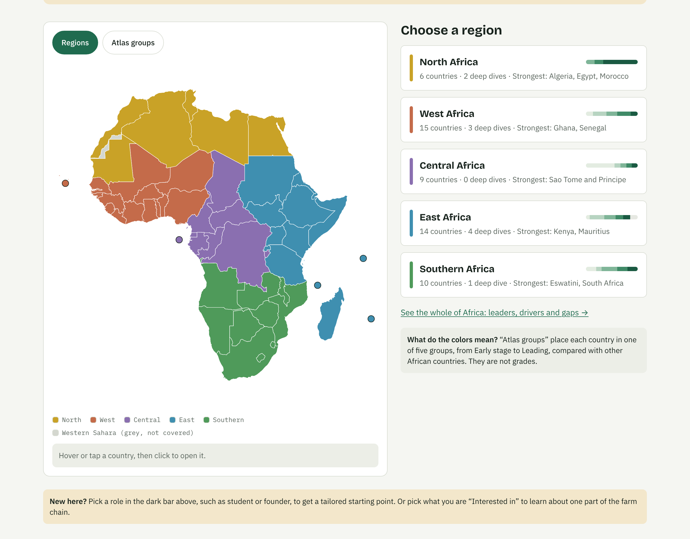
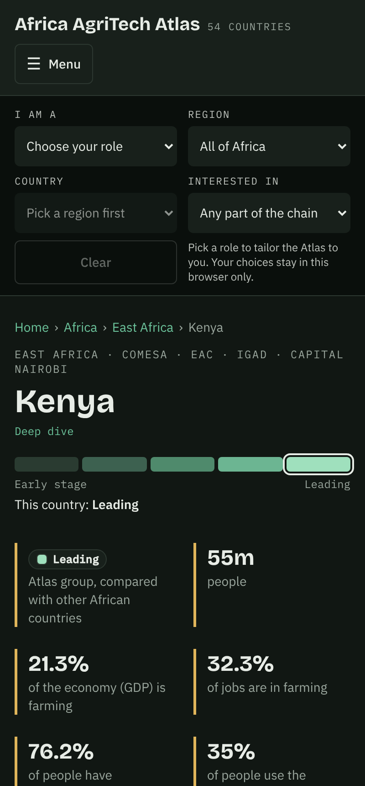

# Africa AgriTech Atlas

**Live site: [africa-agritech-atlas.vercel.app](https://africa-agritech-atlas.vercel.app)**

A living, searchable map of agricultural and infrastructure technology across all 54 African countries. It shows who is building, who funds, who regulates, where countries lead or lag and why. The goal is simple: someone who wants to help with African agriculture arrives, and leaves knowing **a real problem** and **who to talk to** about it. Pick who you are (student, founder, investor, policy professional or researcher), a region and a part of the farm chain, and every page adjusts to you.

## What is inside

| Page | What you find |
| --- | --- |
| Home | Clickable Africa map, Crop Journeys, a "For you" panel for your role, latest news |
| Africa, regions, countries | 54 country profiles (10 in-depth), each with its color group, real indicator figures, people, gaps, startups and policies |
| Gaps | 68 documented, unsolved problems with evidence and where someone could act |
| People | 76 people to learn from, public professional information only |
| Startups and funders | 54 startups (including ones that closed, on purpose) and 25 funders |
| Organizations, Regulation | 139 organizations and 70 policies and frameworks |
| Global | Africa compared with India, Brazil, Vietnam, China, the Netherlands and the US, plus 24 playbooks that closed the gap elsewhere |
| News | Short summaries in our own words, each linking to the original article |
| Crop Journeys | Follow cocoa, maize, coffee and tomatoes from seed to shelf |

Anyone can **suggest an addition or correction**. The owner checks the source before it appears.

## How the color groups work

Countries are placed in one of five groups, **Early stage, Emerging, Middle, Advancing, Leading**, by comparing them with other African countries. They are not grades, and the site never shows a score as a number.

Each country is measured on five equal pillars:

| Pillar | Question | Indicators |
| --- | --- | --- |
| Productivity | How much do farms produce? | Cereal yield; farm value added per worker |
| Inputs & water | Do farmers have fertilizer and irrigation? | Fertilizer per hectare; irrigated share of cropland |
| Policy | Is government committed? | CAADP Biennial Review score; farming's share of public spending |
| Infrastructure | Can farms connect? | Electricity access; internet use |
| Finance | Can farmers pay and borrow? | Adults with a bank or mobile-money account |

Each indicator is ranked against the other African countries with data. A pillar is the average of its indicators, and the overall result is the average of the pillars. A country needs at least 4 of the 5 pillars; otherwise it shows "Not enough data" (Eritrea and Seychelles today). The 52 countries with enough data are split into five equal-sized groups. Country pages show each pillar's group **and** the real figures behind it. Full method: [docs/05-score-method.md](docs/05-score-method.md).

## Data sources

- **Indicators:** FAO and World Bank (via Our World in Data), Global Findex 2024, the African Union's 4th CAADP Biennial Review, ITU
- **People, startups, organizations, policies, gaps:** public sources linked on every record (official sites, news reports, company pages)
- **News:** summaries written for the Atlas, each linking to the original article
- **Map outlines:** Natural Earth (public domain). Western Sahara is shown in grey because its status is disputed

Every record keeps its source link and a "last checked" date. Gaps in the data show as "Not enough data", never as estimates. Records being re-checked show a small "being checked" note.

## How it is built

- [Next.js](https://nextjs.org) on [Vercel](https://vercel.com), deployed from this repository's `main` branch
- [Supabase](https://supabase.com) database. Visitors can only read; suggestions wait for the owner's approval (`supabase/schema.sql`, `phase3.sql`, `phase4.sql`)
- Map drawn with `d3-geo`, `topojson-client` and `world-atlas`
- Content also kept as JSON in [`data/`](data/); the site falls back to these files if the database cannot be reached
- Two scheduled updates keep it fresh: a daily news round-up and a monthly check for changed roles, funding rounds and closed startups ([docs/08-scheduled-updates.md](docs/08-scheduled-updates.md))

To run it on your own computer: install Node.js, then `npm install` and `npm run dev`, and open http://localhost:3000. Without Supabase settings in `.env.local` it reads the files in `data/`.

## About

A solo project by Nnenna Madueke, built in the MIT AI Builder Space. Product spec, build plan and design system are in [`docs/`](docs/).

Spotted something wrong or missing? Use **[Suggest an addition or correction](https://africa-agritech-atlas.vercel.app/suggest)** on the site.
